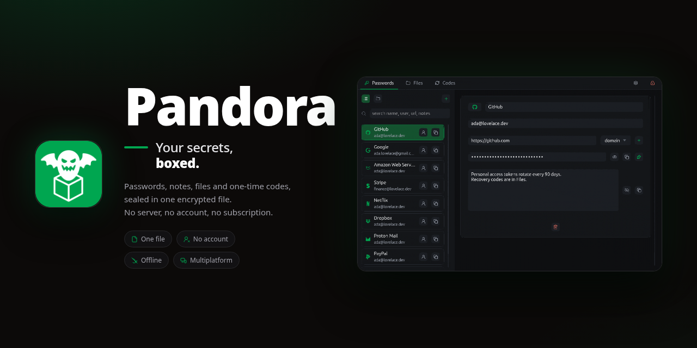

# Pandora



> Your secrets, boxed.

Pandora keeps your logins, notes, files and one-time codes in **one encrypted file
you own**. No account, no server, no sync service. The box is a `.pandora` file:
copy it, back it up, put it on a stick.

**GitHub built in.** Point it at a private repo of yours and Pandora keeps that copy
current — one encrypted blob, no git, nothing readable on GitHub's side. The file on
your disk stays the source.

Native desktop (egui/eframe), same code on Android.

<p align="center">
  
  
  
</p>

## Why Pandora

Every other password manager puts your secrets on someone else's computer. Pandora
does not.

- **Yours.** One file. Uninstall the app and it still opens in the next version.
- **Offline.** Works unplugged, measures nothing. Three requests exist, all
  switchable: the mirror you add, the update check, and — only when you turn it on
  — passwords against a public breach list, sending five characters of a hash and
  nothing else.
- **No lock-in.** JSON manifest, plain Rust, MIT, CSV export in the shape those
  managers already import.
- **Boring crypto.** Argon2id, XChaCha20-Poly1305, the Public Suffix List. Nothing
  homegrown.
- **Honest.** Not audited, plaintext in memory while unlocked, plaintext CSV export.
  All of it is in [`SECURITY.md`](SECURITY.md).
- **Undo.** Autosave, atomic writes, one backup beside the box, a trash and `Ctrl+Z`.

**Not for teams.** No sharing, roles, admin console or account recovery — there is no
account. Need those? Use a hosted manager.

## First questions

**Where does the file go?** Anywhere. Each box can live in its own folder.

**Forgot the master password?** Nothing can reset it. No recovery key, no back door.
Write it down, or use a keyfile.

**Lost the file?** Then you lost that copy. Back it up, or mirror it to a private
GitHub repo.

**What lives outside the box?** Settings, recents and the sealed fingerprint keys —
never vault contents:

| Platform | Data directory |
| --- | --- |
| Linux | `${XDG_DATA_HOME:-~/.local/share}/pandora/` |
| macOS | `~/Library/Application Support/pandora/` |
| Windows | `%LOCALAPPDATA%\pandora\` |
| Android | the app's private directory, handed over by the activity |

**Can I get my data back out?** Yes: CSV for logins, notes and codes, and documents
through Save. Both are plaintext and both warn you first.

## Features

### Passwords

- Logins with a name, username, password, notes and **one or more URLs**.
- Each URL carries a rule — `domain` (default), `host`, `prefix`, `never`. So
  `mail.google.com` fills `accounts.google.com`, and `github.com` never fills
  `github.com.evil.com`.
- Folders, drag to move, grouped views, and `Ctrl+K` over the whole box: names,
  users, addresses, notes, folders, note bodies, code names. Never passwords, seeds
  or file bytes.

### Files

- A note is text, a document is bytes. Different types, so neither can carry the
  other.
- Images, PDF pages, text and code preview in place. Audio plays. Video and archives
  are save-only.
- Streamed into encrypted chunks, so no per-file ceiling. Previews stop at 64 MiB.

### Codes

- TOTP in Base32 or `otpauth://`, SHA-1/256/512, 6–8 digits, custom period.
- A seed can come from a QR: clipboard, file, photo picker, or the live scanner on a
  phone (ZXing, via `rxing`).

### Auto-type

- `Ctrl+T` types the selected login into whatever window has the focus, for the sites a
  browser extension cannot fill: a native app, a remote desktop, a terminal.
- The sequence is per login: `{USERNAME}`, `{PASSWORD}`, `{OTP}`, `{ENTER}`, `{TAB}` and
  `{WAIT 250}`, with `{USERNAME}{TAB}{PASSWORD}{ENTER}` as the default.
- It types with what the session already has — `xdotool` on X11, `wtype` or `ydotool` on
  Wayland — and says so when none of them is installed instead of doing nothing.

### Passkeys

- A passkey lives in the box like everything else: the private key, the credential id
  and the handle are payload fields. The extension on **Chrome 129+** creates and uses
  them; no browser sees a key.
- The credential is bound to its origin (`rpIdHash`), an assertion needs the box
  unlocked, and the attestation is `none`. Firefox has no provider API, so passkeys are
  Chrome-only and the extension says so.

### Sealed shares

- One record sealed for somebody else: a `.pandora-share` file that only their key — or
  a passphrase you agree on — opens. No account, no server, no link that expires.
- The box keeps the keypair a share is sealed to inside the payload; the public half is
  one line you hand over in a chat.

### Recovery code

- One printed code opens the box when the master password is gone. It wraps the box's
  own key; it is not a reset, and a box whose code was never made stays unrecoverable.
- Changing the password drops it, on purpose: what it wraps is the key being replaced.

### Around the box

- Ed25519 keys kept **in the box**, never as files, served to `ssh` and `git` on a Unix
  socket the user turns on in Settings → box → SSH agent.
- Only the keys marked **allowed** are listed and only they sign; the socket is `0600`
  and answers only while a box is unlocked — locking it empties the agent.
- Keys are made here. A private key file from another machine is not imported: it has
  its own format, its own parser and its own policy.

```sh
export SSH_AUTH_SOCK="${XDG_RUNTIME_DIR:-$HOME/.local/share/pandora}/pandora-agent.sock"
ssh-add -L        # the keys you allowed
```

To have the app — and with it the agent — up with the session, one unit each:

```ini
# ~/.config/systemd/user/pandora.service
[Unit]
Description=Pandora
[Service]
ExecStart=%h/.local/bin/pandora
Restart=on-failure
[Install]
WantedBy=default.target
```

```sh
systemctl --user enable --now pandora
```

On macOS, a launch agent does the same, and `SSH_AUTH_SOCK` goes into the shell profile:

```xml
<!-- ~/Library/LaunchAgents/dev.pandora.app.plist -->
<?xml version="1.0" encoding="UTF-8"?>
<!DOCTYPE plist PUBLIC "-//Apple//DTD PLIST 1.0//EN" "http://www.apple.com/DTDs/PropertyList-1.0.dtd">
<plist version="1.0"><dict>
  <key>Label</key><string>dev.pandora.app</string>
  <key>ProgramArguments</key>
  <array><string>/Applications/Pandora.app/Contents/MacOS/pandora</string></array>
  <key>RunAtLoad</key><true/>
</dict></plist>
```

```sh
launchctl load ~/Library/LaunchAgents/dev.pandora.app.plist
export SSH_AUTH_SOCK="$HOME/Library/Application Support/pandora/agent.sock"
```

### Around the box

- **Password generator** with length and character classes, on `Ctrl+3`.
- **Multiple boxes** in tabs, each with its own master password.
- **Trash and undo.** Deleting is reversible until the trash is emptied; only then
  are a document's bytes erased.
- **Edits written on close**, with a 60 s safety net for the rest; atomic writes, one
  `.bak` beside the box.
- **CSV import/export**, reading KeePassXC, KeePass and Bitwarden aliases.
- **GitHub mirror.** One encrypted blob through the Contents API. Private repos
  only, and one made public later is refused on the next push.
- **Folder mirror.** One encrypted file written in place, guarded by the
  provider's stamp and merged when both sides moved. Any folder will do — see
  [Folder mirror](#folder-mirror).
- **Browser extension.** Chrome and Firefox, filling logins and codes through a
  native host. It never reads the vault and never runs the crypto.
- **Autofill on Android.** The phone's own fill panel, in any app whose login form
  is a WebView: the entries claiming the page, one row each, and the codes for a
  field that asks for one. It reads the box open in the app and nothing else.
- **Updates.** A newer release is offered as a strip; the click downloads it, checks
  the published SHA-256 and swaps the file. Nothing installs without that click.
- **Fingerprint unlock** on Android, sealed in the platform keystore.
- **Settings:** one page per box, one for the app (English or Spanish, dark or
  light).

### Folder mirror

Point a box at any folder and it keeps that box's file there. The folder is the
transport: a disk, a Syncthing folder, a WebDAV mount — the mirror never knows how
the bytes travel, so the same code runs against all of them.

- **No account.** No token, no OAuth, no sign-in. On Android the folder comes from
  the system picker (SAF); on a desk it is a directory.
- **One file, written in place.** The mirror is `vault.pandora`. A look compares
  the provider's modification stamp with the one the box last saw and reads the
  bytes only when it moved. A write re-checks the stamp inside the write and
  refuses when the file moved under it; the next pass reads, merges or adopts.
- **History is the provider's.** There are no numbered versions, no `keep` depth
  and no pruning. Drive, Syncthing or the filesystem keeps whatever history the
  user asked them to keep.
- **Divergence is merged, not asked about.** The digest the box last synced is the
  base; when both sides moved they are folded together, conflicts are kept twice,
  and the status line says what happened. An open editor counts as unsaved work,
  so its box is merged, never replaced.
- **What it does not guarantee.** A write cut in half can leave a truncated remote
  until the next save; recovery is the provider's history. Every changed file is
  read and hashed whole, so a big box over a slow link is slow — there is no range
  request and no delta.
- **The key stays here.** What lands in the folder is the encrypted box, the same
  bytes the GitHub mirror would hold. A folder holding a copy this box's key does
  not open is paused, never overwritten; so is a folder that refuses writes.

**Not here yet, on purpose.** The Drive API, which would need OAuth. It is one more
transport behind the same `Folder`, not a redesign of the box or the mirror.

## How it works

```
desktop / phone ──────▶ Pandora app ──────▶ one encrypted .pandora file
                             │
                             ├───────────▶ GitHub repo or a folder (optional mirror)
                             │
browser extension ──▶ native host ──▶ local bridge (the app holds the key)

phone's fill panel ──▶ the app's copy of the open box (no socket, no second file)
```

The app holds the key while a box is unlocked. The browser asks a small native host,
which relays to the app — or opens the box itself, if you allowed that in Settings →
Browser. Android's fill panel cannot do that: it may be started with no activity at
all, so the app leaves it a copy of the open box instead, dropped the moment the box
locks.

A box is a 4 KiB header, 1 MiB encrypted chunks and an encrypted manifest. Only v4
opens; an older container is refused rather than migrated. Byte layout in
[`AGENTS.md`](AGENTS.md#vault-format).

The vault core has no UI and no platform knowledge, so desktop and phone run the same
code. [`AGENTS.md`](AGENTS.md) maps the tree; the phone has
[`android/README.md`](android/README.md) and the browser side
[`../extension/README.md`](../extension/README.md).

## Security

- **Key.** Argon2id, 64 MiB, 3 passes, 4 lanes, derived off the UI thread.
- **Cipher.** XChaCha20-Poly1305 with a random nonce, in 1 MiB chunks bound to the
  box, the record and the position.
- **Size.** Padded to 4 KiB blocks with a 64 KiB floor, so a one-login box is not
  visibly smaller than a hundred.
- **Keyfile.** Optional: a BLAKE2b digest of a file is mixed into the password. Lose
  it and the vault is gone.
- **Memory and clipboard.** Secrets are `Zeroizing`. A copied password clears after a
  countdown, and an idle box locks after 15 minutes.
- **Limits.** Not audited. Plaintext in process memory while unlocked, so it does not
  stop malware running as you, a debugger, root or a memory dump. Fingerprint unlock
  is as strong as the platform keystore. The CSV export is plaintext by design.

The long form is [`SECURITY.md`](SECURITY.md).

## Install

**Desktop.** Stable Rust (edition 2021):

```sh
cargo run --release
```

Linux needs the ALSA headers (`libasound2-dev`, `alsa-lib-devel`). macOS and Windows
need only the toolchain. Wayland is used when the session offers it; `PANDORA_X11=1`
forces X11, which is what drag-and-drop from the file manager needs. Desktop file and
icons under `assets/app/linux/`; `scripts/appimage.sh` and `scripts/package-macos.sh`
package a release build.

Prebuilt: AppImage on Linux, portable zip and bare `.exe` on Windows, universal
`.dmg`/`.zip` on macOS. The in-app updater installs them.

**Android.** SDK, NDK and a JDK 17–25:

```sh
ANDROID_HOME=$HOME/Android/Sdk JAVA_HOME=/path/to/jdk-21 scripts/android-apk.sh install
```

`arm64-v8a` only, which is every phone on minSdk 29. See
[`android/README.md`](android/README.md).

**Browser extension.** Lives next door and installs the native host:

```sh
../extension/install.sh
```

## Use

1. **Create a box** with a master password (12 characters minimum) and, if you want,
   a keyfile.
2. **Add records** with `Ctrl+N`.
3. **Search** with `Ctrl+K`, or `Ctrl+F` for the current list.
4. **Lock** with `Ctrl+L`, or let the idle timer do it.
5. **Mirror** to GitHub from Settings → GitHub, or to a folder from Settings → the
   box. Reads and pushes run off the UI thread.

### Keyboard

| Shortcut | Action |
| --- | --- |
| `Ctrl+S` | Save now (autosave already runs) |
| `Ctrl+L` | Lock the box |
| `Ctrl+W` | Close the box |
| `Ctrl+Tab` / `Ctrl+Shift+Tab` | Next / previous box |
| `Ctrl+1` | Passwords |
| `Ctrl+2` | Files |
| `Ctrl+5` | Codes |
| `Ctrl+4` | Settings |
| `Ctrl+3` | Password generator |
| `Ctrl+T` | Auto-type the selected login |
| `Ctrl+H` | Review the box |
| `Ctrl+6` / `Ctrl+7` | Cards / identities |
| `Ctrl+K` | Search the whole box |
| `Ctrl+F` | Focus the search field |
| `Ctrl+N` | New record |
| `F2` | Rename folder |
| `Delete` | Move the selected record to the trash |
| `Ctrl+Z` | Undo the last delete |
| `Ctrl+C` / `Ctrl+B` | Copy the selected password / username |
| `Escape` | Clear the selection, or close the dialog |
| Browser Back | Go back (also the Android back button) |

Below 620 px the layout collapses to one column, which is what the phone uses.

### Reproducible builds

The release AppImage is built twice from a clean tree by `scripts/repro.sh`, and the
two files are compared byte for byte. Every release carries `reproducible.txt` with the
answer, and the recipe is the script itself:

```sh
scripts/repro.sh      # reproducible: yes <sha256>
```

Three things make the passes agree: the compiler is pinned (`rust-toolchain.toml`), the
build's timestamps come from the commit (`SOURCE_DATE_EPOCH`), and every absolute path
rustc would embed — the checkout, the cargo registry, the target directory — is remapped
to `/build/...` by `scripts/appimage.sh`.

### Environment

| Variable | Effect |
| --- | --- |
| `PANDORA_X11=1` | Force winit's X11 backend on Linux, which is what brings back drag-and-drop. |
| `PANDORA_DATA_DIR` | Data directory for the native host. Used by the flatpak browser install; the app itself always uses the platform's own. |
| `PANDORA_BRIDGE_SOCKET` | Override the bridge socket path (`$XDG_RUNTIME_DIR/pandora-bridge.sock` by default). |
| `PANDORA_GITHUB_CLIENT_ID` | Build-time OAuth client id for the GitHub mirror. Without it, sign-in is refused. |

## Development

```sh
cargo run                         # the GUI; needs a display
cargo test                        # full suite, ~25 s
cargo audit                       # advisories in the dependency tree
cd fuzz && cargo fuzz run codec   # the parsers, on nightly (see fuzz/README)
cargo test vault::store           # one module
cargo test create_open_roundtrip  # one test
cargo fmt
cargo clippy --all-targets
```

GitHub sign-in is compiled in from `PANDORA_GITHUB_CLIENT_ID` (set in
`.cargo/config.toml`, not committed); without it the GitHub flow is refused and local
boxes are unaffected.

Releases — workflow, artifacts, the Android signing key, `act` — are in
[`AGENTS.md`](AGENTS.md#releases). Read that file before changing architecture.

## Limitations

- iOS is not wired up: the icons exist, the entry point does not.
- A phone keeps three panes on the floor: cards, identities, review and the SSH agent
  are reached from a wide window (or, for cards and identities, from the search
  palette).
- Auto-type types into whatever has the focus; it does not check the window's title the
  way KeePassXC does, so a mistimed click types into the wrong window.
- The SSH agent makes its keys; importing an OpenSSH private key is not implemented.
- Changing the master password drops the box's other factors — the YubiKey and the
  recovery code — because both are derived from the key being replaced. Re-enrol them
  after a change; the settings page says so.
- A passkey cannot be shared, and only Chrome 129+ can use one.
- Only the AppImage is checked byte for byte (`scripts/repro.sh`); Windows, macOS and
  the APK are not compared.
- Android autofill answers for WebViews only: a native app has no URL, so no stored
  entry claims it, and Chrome keeps its own forms out of the framework entirely.
  Codes are offered in any app, unfiltered by site.
- GitHub caps a blob at 100 MB, so a box with a huge attachment may not fit there;
  the folder mirror has no such ceiling. Local storage has none at all.
- A keyfile box cannot be opened from the browser.
- No video preview, no auto-type, no server-side sync, no plugin API.
- The format is not frozen: v4 is all this version reads and writes, and a future
  version may add fields (they must be optional).
- Android packages only `arm64-v8a`.

## License

MIT. See [`LICENSE`](LICENSE).

## Credits

- [egui / eframe](https://github.com/emilk/egui) — the immediate-mode UI.
- [Argon2](https://github.com/RustCrypto/password-hashes) and
  [XChaCha20-Poly1305](https://github.com/RustCrypto/AEADs) — the crypto.
- [rxing](https://github.com/rxing-core/rxing) (ZXing) — QR reading.
- [hayro](https://github.com/typst/hayro) — PDF rasterization; [rodio](https://github.com/RustAudio/rodio)
  — audio.
- [Lucide](https://lucide.dev) (ISC) and [simple-icons](https://simpleicons.org)
  (CC0) — icons and brand marks.
- [`psl2`](https://crates.io/crates/psl2) — the Public Suffix List.
